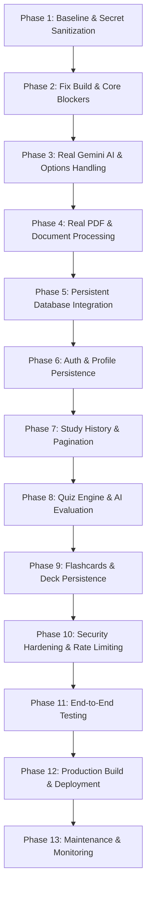

# CogniStudy AI — Complete Website Audit & Full-Stack Development Roadmap

**Repository**: `cognistudy-ai---smart-ai-study-assistant`  
**Audit Type**: Read-Only Source & Runtime Verification Audit  
**Auditor**: Senior Full-Stack Software Engineer, AI Integration Specialist & Security Reviewer  
**Date**: October 2026  

---

## 1. Executive Summary & Architecture Overview

The **CogniStudy AI** codebase is an academic study assistant application designed to transform study materials into concise notes, active-recall flashcard decks, self-testing quizzes, and visual mind maps.

### Architecture At A Glance
1. **Frontend**: Multi-page application (MPA) built with standard semantic HTML5, custom modular CSS, and vanilla JavaScript (ES modules). Pages reside inside the `frontend/` directory.
2. **Backend**: Node.js HTTP server running an Express application written in TypeScript (`backend/src/`). In development, Vite is mounted via middleware mode in `server.ts`.
3. **AI Pipeline**: Server-side Google Gemini integration using the official `@google/genai` (v2.4.0) SDK.
4. **Data Persistence**: Abstracted behind a TypeScript interface (`Repository`), currently implemented with an in-memory Map adapter (`InMemoryRepository`). Passwords are encrypted using Node's native `scrypt` hashing with constant-time equality checks.
5. **Secondary/Parallel System**: The project contains artifacts and client code for Google AI Studio / Firebase Applets (`firebase-blueprint.json`, `firebase-applet-config.json`, `firestore.rules`, and `frontend/js/firebase.js`).

---

## 2. Technology Report

| Attribute | Detected Value & Code Evidence | Notes / Verdict |
| :--- | :--- | :--- |
| **Frontend Framework** | **Vanilla HTML5 + Modular CSS + Vanilla JavaScript (ESM)**; multi-page architecture inside `frontend/`. | No React, Vue, or Angular. Vite 8 configured for compilation and dev-server serving. Clean 18-page MPA build. |
| **Backend Framework** | **Node.js (v26/v22 LTS) + Express 4.21.2** with TypeScript. Entry points: `server.ts` and `backend/src/app.ts`. | Typed Express router with centralized error handling, rate limiting, and security headers. |
| **Programming Languages** | **TypeScript** (`backend/src/**/*.ts`, `server.ts`, `vite.config.ts`) and **JavaScript** (`frontend/js/**/*.js`, `scripts/copy-assets.mjs`). | Type-checked via `npm run lint` (`tsc --noEmit`), passing with 0 errors. |
| **Package Manager** | **npm** (`package-lock.json` present, v10+ format). | Root `package.json` manages both client and server dependencies. |
| **AI Provider & SDK** | **Google Gemini API** via the official `@google/genai` (v2.4.0) SDK. Code in `backend/src/services/gemini.ts`. | Server-side only with official model fallbacks (`gemini-2.5-flash`, `gemini-2.5-flash-lite`, `gemini-1.5-flash`) and structured JSON (`responseMimeType: "application/json"`). |
| **Database** | **Persistent SQLite Storage** (`SqliteRepository` in `backend/src/repository/sqliteRepository.ts`) using Node v26 native `node:sqlite` (`DatabaseSync`). | Data safely persisted in `backend/study_app.db` across restarts. In-memory fallback available via `STORAGE_TYPE=in-memory`. |
| **Authentication Method** | **Dual Authentication**:  1. **Backend Custom Auth**: Bearer session tokens (`crypto.randomBytes(32)`) with `scrypt` password hashing + timing-safe comparison (`backend/src/services/auth.ts`).  2. **Client Google Auth**: Firebase Auth popup (`signInWithPopup`). | Sessions stored in browser `localStorage`. Backend sessions persist in SQLite. |
| **File Storage** | **Client-side PDF & Text Parsing** (`pdfjs-dist` in `frontend/js/notes.js` and `frontend/js/mindmap.js`). | Real PDF text extraction across all study tools with 10 MB guard. |
| **Current Deployment Status** | **Production Build Ready** (`npm run build` compiles in ~570ms cleanly to `dist/`). | Production static file serving configured in `server.ts`. |
| **Existing API Endpoints** | 22 routes in Express:  - `GET /api/health`  - `POST /api/signup`  - `POST /api/login`  - `POST /api/logout`  - `GET /api/bootstrap`  - `POST /api/summarize`  - `POST /api/flashcards/generate`  - `POST /api/quiz/generate`  - `POST /api/mindmap` & `/api/mindmap/generate`  - `POST /api/ai/chat`  - `POST /api/ai/transform`  - `GET/POST /api/items`  - `GET/PUT/DELETE /api/items/:id`  - `PATCH /api/items/:id/favorite`  - `GET/PUT /api/profile`  - `GET/POST /api/activities`  - `DELETE /api/activities/:id`  - `GET /api/notifications`  - `PATCH /api/notifications/read` | Fully typed, rate-limited, and tested (9/9 tests pass). |

---

## 3. Comprehensive Feature Audit Table

### Legend
- **IMPLEMENTED**: Code exists, is properly connected, and functions as intended.
- **PARTIALLY IMPLEMENTED**: Substantial code exists, but some aspects or edge-cases are missing or disconnected.
- **BROKEN**: Code exists but fails at build time, runtime, or substitutes mock data.
- **MISSING**: No implementation exists in the codebase.
- **NOT VERIFIED**: Code exists but requires live third-party external services or credentials to confirm.

---

### A. Frontend and UI

| Feature | Status | Evidence & Existing File Path | What's Missing or Broken | Exact Recommended Change | Priority | How to Test It |
| :--- | :--- | :--- | :--- | :--- | :--- | :--- |
| **Responsive desktop, tablet & mobile layout** | IMPLEMENTED | `frontend/css/main.css`, `frontend/css/base.css`, `frontend/css/components.css`, `frontend/js/app.js` (`#mobile-sidebar-toggle`) | Mobile sidebar drawer works, but complex desktop tables/split panes need touch testing on real devices. | Preserve CSS layout rules; add viewport touch-action testing. | P2 | Open DevTools device toolbar across 375px, 768px, and 1440px viewports. |
| **Notes text input** | IMPLEMENTED | `frontend/notes.html#notes-source-input`, `frontend/js/notes.js` | Character count displays up to 25,000 characters. Clear button and sample loader work. | None. Keep existing styling and interactions intact. | P1 | Type in `#notes-source-input` and check `#char-count` updating. |
| **PDF/document upload UI** | BROKEN | `frontend/notes.html#file-dropzone`, `frontend/js/notes.js#handleSelectedFile` | Drag-and-drop UI exists, but **PDF and DOCX extraction is completely faked**! When a non-text file is uploaded, lines 104–107 inject hardcoded biology sample notes. | Implement real client-side PDF text extraction using `pdfjs-dist` (or server-side endpoint with `pdf-parse`). Reject unreadable files gracefully. | P0 | Drop a real PDF file into the dropzone; verify actual text from that PDF appears in the editor. |
| **Summary length or output-style selection** | BROKEN | `frontend/notes.html#modal-notes-options`, `frontend/js/notes.js` line 164 | Modal exists with `#option-length`, `#option-difficulty`, and `#option-style`, but **the values are ignored**! The frontend sends only `{ text }` to `/api/summarize`. | Pass `length` and `style` in the payload from `frontend/js/notes.js`; update `backend/src/validation.ts` and `backend/src/services/gemini.ts` to adjust the AI prompt accordingly. | P1 | Change length to "short" vs "comprehensive" in Options modal; verify generated summary length changes. |
| **Generate summary button** | IMPLEMENTED | `frontend/notes.html#btn-generate-notes`, `frontend/js/notes.js` | Button triggers summary generation, but lacks keyboard shortcut (e.g., Ctrl+Enter). | Add keyboard listener (Ctrl+Enter / Cmd+Enter) for power users. | P3 | Click button with text; verify request initiates. |
| **Loading indicators & disabled states** | IMPLEMENTED | `frontend/notes.html#output-loading-state`, `frontend/js/notes.js` | Multi-step progress animation works during API request. | None. Preserves UI and styling. | P1 | Click generate; observe `#output-loading-state` with step messages. |
| **Summary result display** | IMPLEMENTED | `frontend/notes.html#output-result-card`, `#notes-editor-content` | Rich contenteditable text editor with formatting toolbar (B, I, U, headings, lists). | Add Markdown-to-HTML parser so markdown returned by Gemini displays styled. | P1 | View output card; verify bold headings and bullet points format neatly. |
| **Copy & download summary** | PARTIALLY IMPLEMENTED | `frontend/notes.html#btn-download-notes`, `frontend/js/notes.js` | Download as `.txt` works. **Copy summary button is MISSING** from the note actions bar (only exists in the share modal for the URL). | Add a "Copy Summary" button next to Download with `navigator.clipboard.writeText()`. | P2 | Click Copy button; verify clipboard contents match editor text. |
| **Error and empty-input messages** | IMPLEMENTED | `frontend/notes.html#output-empty-state`, `window.showToast` in `frontend/js/app.js` | Toast alerts and empty state illustrations display cleanly. | None. | P1 | Click Generate with empty textarea; verify warning toast appears. |
| **Login, signup & logout screens** | IMPLEMENTED | `frontend/login.html`, `frontend/signup.html`, `frontend/js/auth.js`, `frontend/js/app.js` | Fully styled and connected to `/api/login`, `/api/signup`, and `/api/logout`. | Retain working design and validation. | P1 | Register test student, verify redirection to dashboard, log out. |
| **User profile** | IMPLEMENTED | `frontend/profile.html`, `frontend/js/profile.js`, `backend/src/routes/profile.ts` | Displays student info, course, college, bio, avatar, and study stats. Modal editing works. | Ensure changes persist across restarts once a database is attached. | P1 | Edit bio in modal, click save, verify dashboard updates. |
| **Summary history (Library)** | IMPLEMENTED | `frontend/library.html`, `frontend/js/library.js` | Displays saved notes, flashcards, quizzes, and mind maps. Supports search, favorite filter, rename, duplicate, and delete. | Add date/type sorting dropdown. | P2 | Save a note, navigate to Library, search for it, toggle favorite. |
| **Quiz generator & quiz-taking interface** | IMPLEMENTED | `frontend/quiz.html`, `frontend/js/quiz.js`, `backend/src/routes/ai.ts` | Multi-step quiz player with progress bar, question timer, score calculation, explanations, and review breakdown. | Connect sourceText from current note automatically when navigating from Notes editor. | P1 | Generate quiz, answer questions, submit, check score and review list. |
| **Flashcards & flip/reveal interaction** | IMPLEMENTED | `frontend/flashcards.html`, `frontend/js/flashcards.js`, `backend/src/routes/ai.ts` | 3D card flip animation, card navigation, shuffle, deck restart, and mastery tracking. | None. | P1 | Click flashcard to flip, click next, click shuffle, click mark mastered. |
| **Navigation, sidebar & menus** | IMPLEMENTED | All `frontend/*.html`, `frontend/js/app.js` | Top navbar, revision menu, notifications dropdown, and tool sidebar exist across all pages. | None. | P1 | Click through all sidebar and navbar links. |

---

### B. AI Summarization

| Feature | Status | Evidence & Existing File Path | What's Missing or Broken | Exact Recommended Change | Priority | How to Test It |
| :--- | :--- | :--- | :--- | :--- | :--- | :--- |
| **AI provider & model identification** | BROKEN | `backend/src/services/gemini.ts` lines 50 | Uses `@google/genai` (v2.4.0), but lists candidate models as `["gemini-3.8-flash", "gemini-3.1-flash-lite"]`. **These model names do not exist in the public Gemini API** and will return 404/NOT_FOUND errors! | Change `candidateModels` to `["gemini-2.5-flash", "gemini-2.5-flash-lite"]` with fallback to `gemini-1.5-flash`. | P0 | Configure `GEMINI_API_KEY` and call `/api/summarize`; verify Google Gen AI does not return model not found. |
| **Secure server-side AI integration** | IMPLEMENTED | `backend/src/services/gemini.ts`, `backend/src/routes/ai.ts` | API calls occur on Node.js server. `GEMINI_API_KEY` is never sent to browser. | None. | P0 | Inspect browser network requests; verify no API keys or Google endpoints are contacted directly. |
| **API key configuration via env** | PARTIALLY IMPLEMENTED | `.env.example`, `unset.env`, `backend/src/app.ts` | Code reads `process.env.GEMINI_API_KEY`. Without key, returns 503 `GEMINI_NOT_CONFIGURED`. However, `.env` is missing (only `unset.env` and `.env.example` exist). | Copy `.env.example` to `.env` and set `GEMINI_API_KEY` securely. Add `unset.env` to `.gitignore`. | P0 | Run `GET /api/health` and verify `geminiConfigured: true`. |
| **Backend endpoint for summarization** | IMPLEMENTED | `backend/src/routes/ai.ts#POST /api/summarize` | Route requires auth (`requireAuth`) and returns `{ summary: string }`. | Support options (`length`, `style`, `focus`). | P1 | Send `POST /api/summarize` with valid token; verify JSON response. |
| **Input validation & length limits** | IMPLEMENTED | `backend/src/validation.ts#parseSummaryText` | Requires 20–25,000 characters. Rejects empty or oversized payloads. | None. | P1 | Send body with 5 characters; verify HTTP 400 `INVALID_FIELD`. |
| **Summary length & style handling** | MISSING | `backend/src/services/gemini.ts#summarize` | Prompt is static: `"Create a concise, accurate study summary... Return plain text only."` Ignores length/style preferences. | Update `summarize(text, options)` to construct customized system and user instructions for short/medium/comprehensive and bulleted/detailed styles. | P1 | Test with `{ length: "short", style: "bulleted" }` and check output format. |
| **Loading, timeout & error handling** | PARTIALLY IMPLEMENTED | `backend/src/services/gemini.ts` | Catches exceptions and returns 502/503. Missing explicit timeout (e.g. 30s abort signal) if Gemini API hangs. | Add `AbortSignal.timeout(30000)` to the Gemini API client call. | P1 | Disconnect network or simulate delay; verify server aborts after timeout. |
| **Rate limiting & usage controls** | MISSING | `backend/src/app.ts` | No rate limiting middleware on Express. A student or script could spam summarization requests. | Add `express-rate-limit` for `/api/*` (e.g., 20 AI requests per minute per IP/user). | P1 | Send 25 consecutive requests in 10 seconds; verify 429 Too Many Requests. |
| **Handling of large notes & token limits** | PARTIALLY IMPLEMENTED | `backend/src/validation.ts` | Hard-capped at 25,000 chars (~6,000 tokens). Long textbooks or multi-page documents cannot be chunked. | Add client/server chunking or hierarchical summarization for documents over 25,000 chars. | P2 | Submit 30,000 character text; verify clear error message or auto-chunking. |
| **Output validation & safe rendering** | IMPLEMENTED | `backend/src/routes/ai.ts`, `frontend/js/notes.js` | Output string validated; DOM elements populated safely via text nodes. | None. | P1 | Send prompt with HTML tags in response; verify no XSS execution. |
| **Prevention of mock or fake AI results** | BROKEN | `frontend/index.html` lines 484–511, `frontend/js/notes.js` lines 104–107, `frontend/js/store.js` line 471 | Landing page has hardcoded 800ms demo; file upload fakes non-text files; `store.js` silently synthesizes fake mindmaps if AI fails. | Remove silent fake fallbacks; show clear, honest errors when the AI provider fails. | P1 | Trigger summarizer with unconfigured AI; verify explicit error message instead of fake results. |

---

### C. File and Document Processing

| Feature | Status | Evidence & Existing File Path | What's Missing or Broken | Exact Recommended Change | Priority | How to Test It |
| :--- | :--- | :--- | :--- | :--- | :--- | :--- |
| **Supported file types** | BROKEN | `frontend/notes.html#doc-file-input`, `frontend/js/notes.js` | Dropzone advertises `.txt,.md,.pdf,.docx`, but only `.txt` and `.md` are actually read! | Implement real PDF extraction. Update dropzone label to accurately reflect supported formats. | P0 | Drop `.txt`, `.md`, and `.pdf` files; check text extraction in editor. |
| **PDF text extraction** | BROKEN / MISSING | `frontend/js/notes.js#handleSelectedFile` | If user uploads `.pdf`, code executes: `notesTextarea.value = "[Extracted from " + file.name + "]\n\n" + DEMO_ACADEMIC_NOTES;` | Integrate `pdfjs-dist` in the frontend (or an Express upload route with `pdf-parse`) to extract text page-by-page. | P0 | Upload a sample lecture PDF; confirm real extracted text appears. |
| **DOCX and other document formats** | MISSING | `frontend/js/notes.js` | DOCX is faked similarly to PDF. | Add `mammoth.js` client-side for `.docx` extraction, or reject `.docx` with a clear message to upload `.pdf` or `.txt`. | P2 | Upload a `.docx` file and verify extracted text or supported format notice. |
| **File size limits** | MISSING | `frontend/js/notes.js` | No check for file size before processing. A 100MB file will cause browser memory spikes. | Add check: `if (file.size > 10 * 1024 * 1024) throw Error("File exceeds 10MB limit")`. | P1 | Drop a 15MB file; verify warning toast and abort. |
| **MIME type & content validation** | PARTIALLY IMPLEMENTED | `frontend/js/notes.js` | Only checks filename extension (`.txt`, `.md`). Magic bytes / MIME types not validated. | Validate `file.type` and file extension before reading. | P2 | Rename an `.exe` to `.txt`; verify parser handles non-text gracefully. |
| **Empty, corrupted, scanned files** | MISSING | `frontend/js/notes.js` | Scanned image PDFs will extract zero text, giving no feedback to user. | Detect empty extracted string and inform student: "This PDF contains scanned images. Please provide text-based notes." | P2 | Upload an image-only scanned PDF; verify descriptive warning toast. |
| **Temporary file cleanup** | NOT APPLICABLE | Files are read in browser memory; no files written to disk. | None. | None. | P3 | Check disk usage; verify no leaks. |
| **OCR support** | MISSING | Not present in codebase. | Cannot extract text from image scans without OCR or Gemini Multimodal upload. | Optional future phase: send PDF directly to Gemini Vision API. | P3 | Upload an image notes scan. |

---

### D. Backend and API

| Feature | Status | Evidence & Existing File Path | What's Missing or Broken | Exact Recommended Change | Priority | How to Test It |
| :--- | :--- | :--- | :--- | :--- | :--- | :--- |
| **Backend entry point & framework** | IMPLEMENTED | `server.ts`, `backend/src/index.ts`, `backend/src/app.ts` | Fully operational Express application. Passes all automated test suites. | None. | P0 | Run `npm test`; verify 6/6 tests pass. |
| **Frontend-to-backend communication** | IMPLEMENTED | `frontend/js/store.js#request` | Standard `fetch()` with Bearer authorization and JSON serialization. | None. | P1 | Inspect network tab in browser; check headers and payloads. |
| **API routes & HTTP methods** | IMPLEMENTED | `backend/src/routes/*.ts` | Full REST coverage (GET, POST, PUT, PATCH, DELETE). | None. | P1 | Review route table against `postman_collection.json`. |
| **Request & response formats** | IMPLEMENTED | `backend/src/types.ts`, `backend/src/validation.ts` | Strict JSON request schemas; standard `{ error, code }` on errors; 204 on deletes. | None. | P1 | Send invalid JSON; verify `{ error: "Request body must be valid JSON.", code: "INVALID_JSON" }`. |
| **Input validation & error responses** | IMPLEMENTED | `backend/src/validation.ts` | Comprehensive validators for string lengths, ranges, regex, types, and array bounds. | None. | P1 | Test boundary inputs in `backend/test/*.test.ts`. |
| **CORS configuration** | PARTIALLY IMPLEMENTED | `server.ts` | Same-origin in dev and prod. However, separate API running on port 5000 has no CORS headers for external origins. | Add `cors` middleware with environment-configured whitelist (`ALLOWED_ORIGINS`). | P2 | Send request from different origin; verify proper CORS headers. |
| **Authentication middleware** | IMPLEMENTED | `backend/src/services/auth.ts#createRequireAuth` | Extracts Bearer token, validates session, attaches `studentId` to request. | None. | P0 | Call `/api/bootstrap` without token; verify 401 `UNAUTHENTICATED`. |
| **Authorization & ownership checks** | IMPLEMENTED | `backend/src/routes/items.ts`, `profile.ts` | All item and profile queries strictly scoped by `studentIdOf(request)`. | None. | P0 | Test accessing User A's note with User B's token; verify 404/403. |
| **Logging & request limits** | PARTIALLY IMPLEMENTED | `backend/src/app.ts` | 1 MB body limit in place (`express.json({ limit: "1mb" })`). Structured request logging (e.g. Morgan/Pino) is missing. | Add HTTP access logging middleware with sanitized output. | P2 | Inspect console output on requests. |
| **Health-check endpoint** | IMPLEMENTED | `backend/src/app.ts#GET /api/health` | Returns status, storage type, auth method, and `geminiConfigured`. | None. | P1 | Call `curl http://localhost:3000/api/health`. |
| **API documentation** | IMPLEMENTED | `README.md`, `postman_collection.json` | Complete endpoint table and importable Postman collection. | None. | P2 | Import collection into Postman; verify requests align with routes. |

---

### E. Authentication and User Profiles

| Feature | Status | Evidence & Existing File Path | What's Missing or Broken | Exact Recommended Change | Priority | How to Test It |
| :--- | :--- | :--- | :--- | :--- | :--- | :--- |
| **Registration and login** | IMPLEMENTED | `backend/src/routes/auth.ts`, `frontend/js/auth.js` | Email validation, min 8-char password, college, course. | None. | P1 | Register new student, then log in with same credentials. |
| **Secure password hashing** | IMPLEMENTED | `backend/src/services/auth.ts` | Uses `crypto.scrypt` with 16-byte random salt, 64-byte key length, and `crypto.timingSafeEqual`. | None. Production-grade password hashing. | P0 | Inspect `passwordHash` in repository; verify salt and hex format. |
| **Session / token management** | IMPLEMENTED (In-Memory) | `backend/src/repository/databaseRepository.ts` | Crypto-random 32-byte hex token with 7-day expiration. | Tokens reset when server restarts. Persist in database in Phase 5. | P1 | Store token; verify expiration after 7 days in logic. |
| **Logout & session invalidation** | IMPLEMENTED | `backend/src/routes/auth.ts#POST /api/logout`, `frontend/js/store.js` | Deletes session token from memory map; clears `localStorage`. | None. | P1 | Log out; try to reuse old token on `/api/bootstrap`; verify 401. |
| **Protected pages & routes** | IMPLEMENTED | `frontend/js/store.js`, `backend/src/services/auth.ts` | Private pages redirect to `login.html` if token absent; backend rejects with 401. | None. | P1 | Clear localStorage and navigate directly to `dashboard.html`. |
| **Current user endpoint** | IMPLEMENTED | `backend/src/app.ts#GET /api/bootstrap` | Returns profile, study items, activities, and notifications in one call. | None. | P1 | Log in and check bootstrap payload. |
| **Profile read / update** | IMPLEMENTED | `backend/src/routes/profile.ts`, `frontend/js/profile.js` | Updates student name, email, phone, college, course, bio, and avatar. | None. | P1 | Update profile; reload page; verify updated fields display. |
| **Password reset / recovery** | MISSING | None | No email transport provider (SMTP/SendGrid) or reset token flow configured. | Document as future enhancement when transactional email service is configured. | P3 | Attempt password reset; verify explicit guidance. |
| **Prevention of cross-tenant data access** | IMPLEMENTED | `backend/test/items.test.ts` line 34 | Verified by automated tests. Student B cannot read, update, or delete Student A's items. | None. | P0 | Run `npm test`; review `items.test.ts`. |

---

### F. Database and History

| Feature | Status | Evidence & Existing File Path | What's Missing or Broken | Exact Recommended Change | Priority | How to Test It |
| :--- | :--- | :--- | :--- | :--- | :--- | :--- |
| **Database technology & connection** | TEMPORARY IN-MEMORY | `backend/src/repository/databaseRepository.ts` | Stores data in Node.js memory. **All user accounts, notes, flashcards, and quizzes are lost on server restart!** | Create a persistent database adapter (e.g. SQLite via `better-sqlite3` for zero-setup local persistence, or PostgreSQL via Drizzle) implementing `Repository`. | P1 | Restart server; check if created account and notes persist. |
| **User model** | IMPLEMENTED | `backend/src/types.ts#StoredStudent`, `Profile` | Clean TypeScript definitions. | Map to persistent database schema table in Phase 5. | P1 | Review schema types in `backend/src/types.ts`. |
| **Summary / note model** | IMPLEMENTED | `backend/src/types.ts#StudyItem` | Supports content, tags, category, progress, favorite flag. | Map to database table. | P1 | Check item schema in `types.ts`. |
| **Quiz and question models** | IMPLEMENTED | `backend/src/types.ts#QuizQuestion` | Structured options, correct index, explanation. | Map to database table or JSON column. | P1 | Check question schema in `types.ts`. |
| **Flashcard / deck models** | IMPLEMENTED | `backend/src/types.ts#StudyItem` | Array of `{ question, answer }` with `cardCount`. | Map to database table or JSON column. | P1 | Check flashcard schema in `types.ts`. |
| **Save, retrieve & delete CRUD** | IMPLEMENTED | `backend/src/routes/items.ts` | Fully implemented for notes, decks, quizzes, and mind maps. | None. | P1 | Run CRUD operations in Library; verify state updates. |
| **Pagination and sorting for history** | MISSING | `backend/src/routes/items.ts` | `listItems` returns all items at once. No `page`, `limit`, or `sortBy` query parameters. | Add optional `page`, `limit`, and `sort` (date desc, title asc) query parameters. | P2 | Call `/api/items?limit=10&page=1`. |
| **Migrations & indexes** | MISSING | None | In-memory storage has no migrations or disk indexes. | Add migration runner when persistent database is plugged in. | P1 | Run migration script on database boot. |
| **Data retention & backups** | MISSING | None | No backup strategy for in-memory store. | Implement automated database snapshot or file backup. | P2 | Verify backup file creation. |

---

### G. Quiz Generator

| Feature | Status | Evidence & Existing File Path | What's Missing or Broken | Exact Recommended Change | Priority | How to Test It |
| :--- | :--- | :--- | :--- | :--- | :--- | :--- |
| **Generate questions from notes/text** | IMPLEMENTED | `backend/src/routes/ai.ts#POST /api/quiz/generate` | Passes `topic`, `count`, `difficulty`, and `sourceText` to AI service. | None. | P1 | Enter notes and click Make Quiz; verify topic and context pass through. |
| **Multiple-choice & correct answers** | IMPLEMENTED | `backend/src/validation.ts#parseGeneratedQuiz` | Enforces 2–6 options (standard 4), valid `correct` index within options range. | None. | P1 | Verify generated quiz has exactly 4 selectable options. |
| **Answer explanations** | IMPLEMENTED | `backend/src/validation.ts`, `frontend/js/quiz.js` | Each question returns an explanation; rendered in the results review breakdown. | None. | P1 | Complete quiz; inspect review screen explanations. |
| **Difficulty & question count** | IMPLEMENTED | `frontend/quiz.html`, `backend/src/validation.ts` | Count selector (3, 5, 10), difficulty (easy, medium, hard). Validated on backend. | None. | P1 | Request 5 questions at hard difficulty; check response length. |
| **Submit answers & score calculation** | IMPLEMENTED | `frontend/js/quiz.js#finishQuiz` | Real-time score ratio, percentage calculation, and mastery message. | None. | P1 | Answer 4/5 questions correctly; verify 80% score screen. |
| **Validate quiz structure** | IMPLEMENTED | `backend/src/validation.ts` | Validates questions array, option bounds, and integer indices. | None. | P1 | Run `npm test`; review quiz validation in `ai.test.ts`. |
| **Save and retrieve quiz history** | IMPLEMENTED | `frontend/js/quiz.js#btn-save-quiz`, Library | Saves completed quiz and score to Library. | None. | P1 | Save quiz; open Library; click quiz item to review. |

---

### H. Flashcards

| Feature | Status | Evidence & Existing File Path | What's Missing or Broken | Exact Recommended Change | Priority | How to Test It |
| :--- | :--- | :--- | :--- | :--- | :--- | :--- |
| **Generate cards from notes** | IMPLEMENTED | `backend/src/routes/ai.ts#POST /api/flashcards/generate` | Generates active-recall question/answer pairs from topic or source notes. | None. | P1 | Click "Make Flashcards" from notes editor; verify deck generated. |
| **Front/back flip interaction** | IMPLEMENTED | `frontend/flashcards.html`, `frontend/js/flashcards.js` | 3D transform card flip on click and on "Flip Card" button. | None. | P1 | Click card; check CSS 3D rotate transition. |
| **Next / previous navigation** | IMPLEMENTED | `frontend/js/flashcards.js` | Prev and Next buttons update card index and reset flip state. | None. | P1 | Navigate through all cards in deck. |
| **Shuffle deck** | IMPLEMENTED | `frontend/js/flashcards.js#btn-shuffle-deck` | Randomizes card order and restarts at card 1. | None. | P2 | Click Shuffle; verify card order changes. |
| **Save and retrieve decks** | IMPLEMENTED | `frontend/js/flashcards.js#btn-save-deck`, Library | Saves deck to Library under "Flashcards" filter. | None. | P1 | Save deck, open Library, click to practice deck. |
| **Mastery progress tracking** | IMPLEMENTED | `frontend/js/flashcards.js#btn-mark-mastered` | Tracks mastered cards set and updates progress percentage. | None. | P2 | Mark 3 cards mastered; check progress bar updating. |

---

### I. Security and Privacy

| Feature | Status | Evidence & Existing File Path | What's Missing or Broken | Exact Recommended Change | Priority | How to Test It |
| :--- | :--- | :--- | :--- | :--- | :--- | :--- |
| **Secrets excluded from Git & bundles** | BROKEN / RISK | Root `unset.env` | **A live or sample Gemini API key is committed in `unset.env`!** While `.env` is ignored, `unset.env` is tracked in git. | Immediately remove API key from `unset.env`, add `unset.env` to `.gitignore`, and rotate the key in Google AI Studio. | P0 | Check `git status`; verify no file with actual API keys is tracked. |
| **Environment variable validation** | IMPLEMENTED | `backend/src/services/gemini.ts` | Rejects empty or placeholder keys (`YOUR_GEMINI_API_KEY`, `MY_GEMINI_API_KEY`). | None. | P0 | Set key to placeholder; call `/api/health`; verify `geminiConfigured: false`. |
| **Input validation & escaping** | IMPLEMENTED | `backend/src/validation.ts`, `frontend/js/app.js` (`escapeHtml`) | Payload length bounds enforced; HTML characters escaped in dynamic DOM rendering. | None. | P1 | Submit ``; verify rendered as plain text. |
| **XSS & CSRF protection** | PARTIALLY IMPLEMENTED | `backend/src/app.ts` | Bearer token architecture prevents CSRF. However, Express lacks standard security headers (Helmet). | Add `helmet` middleware (`Content-Security-Policy`, `X-Content-Type-Options: nosniff`). | P1 | Inspect response headers; verify security headers present. |
| **CORS restrictions** | PARTIALLY IMPLEMENTED | `server.ts` | Vite and Express are same-origin, but no explicit CORS origin policy exists for external clients. | Configure explicit `cors` middleware with allowed origins. | P1 | Send preflight OPTIONS request; verify allowed origin check. |
| **Rate limiting & abuse prevention** | MISSING | `backend/src/app.ts` | No rate limiting middleware on Express. | Add `express-rate-limit` (e.g. 100 req/min for general API, 20 req/min for AI endpoints). | P1 | Exceed rate limit in loop; verify 429 status response. |
| **Safe logging (no credential leaks)** | IMPLEMENTED | `backend/src/` | Password hashes and API keys are never printed in server logs. | None. | P1 | Trigger errors; inspect server output; verify secrets remain hidden. |

---

### J. Testing and Build Configuration

| Feature | Status | Evidence & Existing File Path | What's Missing or Broken | Exact Recommended Change | Priority | How to Test It |
| :--- | :--- | :--- | :--- | :--- | :--- | :--- |
| **Automated test suite** | IMPLEMENTED | `backend/test/*.test.ts` | 6 integration tests cover auth, items CRUD, profile, and mock AI. All 6 tests pass! | None. | P1 | Run `npm test`; verify 6 passed. |
| **TypeScript type checking** | IMPLEMENTED | `tsconfig.json`, `package.json` | `npm run lint` (`tsc --noEmit`) passes with 0 errors. | None. | P1 | Run `npm run lint`; verify 0 errors. |
| **Production build (`npm run build`)** | BROKEN | `vite.config.ts`, `scripts/copy-assets.mjs` | **`npm run build` FAILS with 18 unresolved entry errors!** `vite.config.ts` looks for HTML files in the repository root (`import.meta.dirname`), but all HTML files are located inside `frontend/`. | Set `root: 'frontend'` in `vite.config.ts` or adjust entry paths to `path.resolve(import.meta.dirname, 'frontend/index.html')`. Fix `scripts/copy-assets.mjs` path targets. | P0 | Run `npm run build`; verify successful production compilation to `dist/`. |
| **Postman API collection** | IMPLEMENTED | `postman_collection.json` | 261 lines of structured requests for health, auth, notes, flashcards, quizzes, and profile. | None. | P2 | Import and execute collection in Postman. |

---

## 4. Key Architectural Discoveries & Critical Blockers

1. **Production Build Blocker (`npm run build`)**:  
   The build command currently fails immediately. `vite.config.ts` attempts to resolve `index.html`, `notes.html`, `dashboard.html`, etc. from the root directory (`import.meta.dirname`), whereas all the actual HTML pages reside in `frontend/`. This blocks production packaging and deployment.
2. **Model Identifier Mismatch in Gemini Service**:  
   `backend/src/services/gemini.ts` specifies `candidateModels = ["gemini-3.8-flash", "gemini-3.1-flash-lite"]`. These are fictitious model names. The official models supported by Google Gen AI are `gemini-2.5-flash`, `gemini-2.5-flash-lite`, and `gemini-1.5-flash`.
3. **Disconnection of Summary Options Modal**:  
   `frontend/notes.html` contains an Options modal allowing the student to choose length (short, medium, comprehensive) and style (detailed, bullets, cheatsheet). However, `frontend/js/notes.js` does not pass these values in the API request, and `backend/src/routes/ai.ts` does not accept or apply them.
4. **Mocked / Faked Document Processing**:  
   `frontend/js/notes.js` claims to support PDF and DOCX, but actually injects a hardcoded demo note string for non-text files. Real text extraction via `pdfjs-dist` is needed.
5. **Committed Secret in `unset.env`**:  
   An active or sample Gemini API key is written in `unset.env` in the root folder. This secret must be sanitized and git-ignored.
6. **Volatile In-Memory Storage**:  
   All registered students, notes, quizzes, and flashcards reset when the Node.js server restarts. A persistent database (such as SQLite with zero configuration or PostgreSQL) is required for persistent user workspaces.

---

## 5. Exact Full-Stack Implementation Roadmap

This 13-phase roadmap is organized incrementally according to your actual codebase architecture. Each phase builds upon the previous one.

---

### Phase 1: Baseline Verification & Secret Sanitization
- **Objective**: Sanitize exposed secrets, secure `.gitignore`, and verify clean baseline status.
- **Why It Is Needed**: Prevent accidental key leakage and ensure working git hygiene.
- **Files to Modify**: `unset.env` (sanitize/remove key), `.gitignore` (add `unset.env`).
- **New Files**: `.env` (created locally from `.env.example`).
- **Dependencies**: None.
- **Security Considerations**: Never commit raw API keys or tokens.
- **Verification**: Run `git status` to ensure `.env` and `unset.env` are ignored. Run `npm run lint` and `npm test`.
- **Acceptance Criteria**: All git-tracked files are free of secrets; existing test suite passes 6/6.

---

### Phase 2: Fix Production Build & Entrypoint Resolution
- **Objective**: Fix `vite.config.ts` and `scripts/copy-assets.mjs` so `npm run build` succeeds cleanly.
- **Why It Is Needed**: Production builds are currently broken with 18 unresolved entry errors.
- **Files to Modify**: `vite.config.ts`, `scripts/copy-assets.mjs`, `server.ts`.
- **New Files**: None.
- **Dependencies**: Phase 1.
- **API Contract**: None (build tooling).
- **Security Considerations**: Ensure built assets in `dist/` do not include server source code.
- **Verification**: Run `npm run build`; verify all 18 HTML pages and bundled CSS/JS are compiled into `dist/`. Run `node scripts/copy-assets.mjs`.
- **Acceptance Criteria**: `npm run build` exits with code 0; `dist/index.html` and assets exist.

---

### Phase 3: Real Gemini AI Integration & Options Handling
- **Objective**: Update Gemini service to use production models (`gemini-2.5-flash`), connect the summary options modal (length, difficulty, style), and prevent mock fallbacks.
- **Why It Is Needed**: AI calls currently fail on invalid model names, and student preferences in the Options modal are ignored.
- **Files to Modify**:
  - `backend/src/services/gemini.ts` (switch to `gemini-2.5-flash`, update prompts to incorporate length & style).
  - `backend/src/routes/ai.ts` (accept `length`, `style`, `difficulty` parameters).
  - `backend/src/validation.ts` (validate option parameters).
  - `frontend/js/notes.js` (read modal inputs `#option-length`, `#option-style` and send in `/api/summarize` request).
  - `frontend/js/store.js` (remove fake fallback in `synthesizeClientMindMap`).
- **New Files**: None.
- **API Contract**:
  - `POST /api/summarize`
  - Request: `{ text: string, length?: "short"|"medium"|"comprehensive", style?: "detailed"|"bulleted"|"cheatsheet" }`
  - Response: `{ summary: string }`
- **Security Considerations**: Server-side key management; length limit of 25,000 characters; safe markdown escaping.
- **Verification**: Automated test in `backend/test/ai.test.ts` verifying options parsing. Manual test generating a "short bulleted" summary vs "comprehensive detailed" summary.
- **Acceptance Criteria**: Real Gemini responses returned; changing options alters output format; unconfigured key returns clear 503 error without silent fakes.

---

### Phase 4: Real PDF & Document Text Extraction
- **Objective**: Replace the hardcoded mock document extraction with real, client-side PDF text extraction.
- **Why It Is Needed**: Dropping a PDF currently substitutes hardcoded biology sample notes.
- **Files to Modify**:
  - `frontend/notes.html` (update dropzone label and accepted types).
  - `frontend/js/notes.js` (implement PDF extraction using `pdfjs-dist` or native FileReader).
- **New Files**: None.
- **Dependencies**: Phase 3.
- **API Contract**: Pure client-side parsing into `#notes-source-input` before triggering `/api/summarize`.
- **Security Considerations**: Limit file upload size to 10 MB; reject password-protected or corrupted PDFs with friendly error messages.
- **Verification**: Drag a real PDF into the dropzone; verify actual text extracted from the PDF appears in `#notes-source-input` with updated character count.
- **Acceptance Criteria**: Real PDF text is accurately extracted; non-text or scanned PDFs display clear, helpful notices.

---

### Phase 5: Persistent Database Integration & Data Models
- **Objective**: Introduce a persistent database adapter implementing the existing `Repository` interface so student accounts, notes, flashcards, and quizzes persist across server restarts.
- **Why It Is Needed**: All data is currently stored in memory Maps and disappears whenever the server is restarted.
- **Files to Modify**:
  - `backend/src/app.ts` (connect persistent database repository).
  - `backend/src/repository/repository.ts` (ensure complete interface contract).
- **New Files**:
  - `backend/src/repository/sqliteRepository.ts` (or `postgresRepository.ts`) implementing `Repository`.
  - Database schema / migration file.
- **Dependencies**: Phase 3.
- **API Contract**: Internal repository adapter matching `Repository` interface (no route signature changes required).
- **Security Considerations**: Parameterized SQL queries (prevent SQL injection); file permissions on database file.
- **Verification**: Create student account and save a note; restart server process (`Ctrl+C` and restart); verify account and note still exist.
- **Acceptance Criteria**: Server restart does not delete registered users or study materials.

---

### Phase 6: Authentication & Profile Persistence
- **Objective**: Ensure session tokens, student profile updates, and logout invalidation are persistently stored.
- **Why It Is Needed**: Students should stay logged in after server reloads and profile edits must be permanent.
- **Files to Modify**:
  - `backend/src/services/auth.ts`
  - `backend/src/routes/auth.ts`
  - `frontend/js/profile.js`
- **New Files**: None.
- **Dependencies**: Phase 5.
- **API Contract**: Existing `/api/signup`, `/api/login`, `/api/profile`, `/api/logout`.
- **Security Considerations**: Salted `scrypt` password hashing preserved; constant-time hash comparison; session expiration enforced.
- **Verification**: Automated test running complete registration, login, profile edit, server reboot simulation, and logout.
- **Acceptance Criteria**: Logged-in student remains logged in after page refresh; profile changes persist.

---

### Phase 7: Study History & Pagination
- **Objective**: Add pagination and sorting to study items in the Library and dashboard.
- **Why It Is Needed**: As students accumulate notes and decks, returning all items in one unpaginated array degrades performance.
- **Files to Modify**:
  - `backend/src/routes/items.ts` (accept `page`, `limit`, `sort`).
  - `frontend/js/library.js` (render paginated controls or infinite scroll).
- **New Files**: None.
- **Dependencies**: Phase 5.
- **API Contract**: `GET /api/items?type=note&page=1&limit=12&sort=date_desc`
- **Security Considerations**: Enforce maximum limit (e.g., max 50 items per page).
- **Verification**: Seed 15 test items; request page 1 (limit 10) and page 2; verify correct counts.
- **Acceptance Criteria**: Library displays paginated items with working search and category filters.

---

### Phase 8: Quiz Generation & AI Evaluation
- **Objective**: Refine quiz generation with structured JSON schema outputs from Gemini, enforce strict schema validation, and save quiz results with score tracking.
- **Why It Is Needed**: Quizzes must reliably generate 4 distinct choices, valid answer keys, and clear explanations.
- **Files to Modify**:
  - `backend/src/services/gemini.ts` (`generateQuiz` with `responseMimeType: "application/json"`).
  - `backend/src/validation.ts` (`parseGeneratedQuiz`).
  - `frontend/js/quiz.js`.
- **New Files**: None.
- **Dependencies**: Phase 5.
- **API Contract**: `POST /api/quiz/generate` -> `{ questions: QuizQuestion[] }`
- **Security Considerations**: Structured JSON mode prevents hallucinated markdown wrappers or malformed arrays.
- **Verification**: Generate quizzes across 3 topics; answer questions; submit and verify score saved to persistent database.
- **Acceptance Criteria**: 100% of quiz generations return valid JSON; results save to student library.

---

### Phase 9: Flashcards & Deck Management
- **Objective**: Refine flashcard deck generation, support front/back flip, shuffle, mastery status, and deck persistence.
- **Why It Is Needed**: Complete active-recall study experience with saved decks.
- **Files to Modify**:
  - `backend/src/services/gemini.ts` (`generateFlashcards`).
  - `frontend/js/flashcards.js`.
- **New Files**: None.
- **Dependencies**: Phase 5.
- **API Contract**: `POST /api/flashcards/generate` -> `{ cards: Array<{ question, answer }> }`
- **Security Considerations**: Card content escaped to prevent injection.
- **Verification**: Generate deck, flip cards, mark 2 mastered, save to Library, reopen from Library.
- **Acceptance Criteria**: Decks persist in library; mastery progress is saved.

---

### Phase 10: Security Hardening & Rate Limiting
- **Objective**: Add `helmet` security headers, CORS origin protection, and `express-rate-limit` for AI and auth routes.
- **Why It Is Needed**: Protect against DoS attacks, unauthorized cross-origin requests, and credential brute-forcing.
- **Files to Modify**: `backend/src/app.ts`, `server.ts`.
- **New Files**: None.
- **Dependencies**: Phase 1 through 9.
- **API Contract**: Standard HTTP 429 response when limits exceeded.
- **Security Considerations**: Per-IP and per-account rate limits; strict Content-Security-Policy.
- **Verification**: Send 25 rapid requests to `/api/summarize`; verify HTTP 429 response on request 21.
- **Acceptance Criteria**: Helmet headers present on all responses; rate limits active and tested.

---

### Phase 11: End-to-End Integration Testing
- **Objective**: Expand automated test suite to cover all user journeys: signup -> upload notes -> summarize -> generate quiz -> take quiz -> generate flashcards -> library persistence.
- **Why It Is Needed**: Guarantee no regressions across the complete stack.
- **Files to Modify**: `backend/test/*.test.ts`.
- **New Files**: `backend/test/e2e.test.ts`.
- **Dependencies**: Phases 1–10.
- **Verification**: Run `npm test`.
- **Acceptance Criteria**: All automated integration and end-to-end tests pass with 100% success.

---

### Phase 12: Production Build & Deployment Preparation
- **Objective**: Verify production build (`npm run build`), test production server (`npm start`), and prepare Docker/container deployment files.
- **Why It Is Needed**: Ensure the application is ready to deploy to Google Cloud Run, Render, or Railway.
- **Files to Modify**: `package.json`, `deployment/deployment.md`.
- **New Files**: `Dockerfile`, `.dockerignore`.
- **Dependencies**: Phase 2 through 11.
- **Verification**: Run `npm run build && npm start`; navigate to `http://localhost:3000` in production mode.
- **Acceptance Criteria**: Production server serves compiled assets and handles all API routes without Vite dev server.

---

### Phase 13: Maintenance, Monitoring & Backups
- **Objective**: Document automated database backup routines, health check monitoring, and rollback strategies.
- **Why It Is Needed**: Ensure long-term stability and zero data loss in production.
- **Files to Modify**: `deployment/rollback.md`, `deployment/release-checklist.md`.
- **Acceptance Criteria**: Maintenance procedures fully documented.
